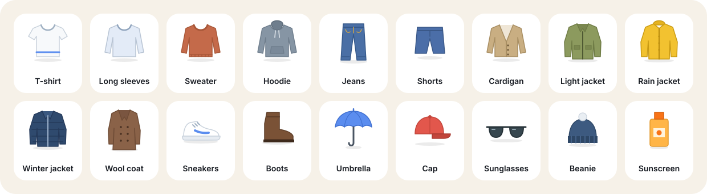

  

  
  
  
  

**Clymo** (formerly DressCast) turns the weather forecast into a simple answer to the question you actually ask every morning: *what should I wear?*

At the time you choose, it sends a notification like **"Light jacket + umbrella today"**. Open the app to see the outfit, tick items off as you get dressed, and find out exactly why each one was picked. No account, no ads, no tracking.

  

## Features

**Every morning**
- A notification at the time you pick, with the outfit, the day's weather and the day's best tip
- An optional 21:00 preview of tomorrow's outfit
- A warning about an hour before rain starts, while you're out
- **Official weather warnings** (yellow, orange, red) from your national weather service, via MeteoAlarm
- A heads-up when the **pollen** you're allergic to is high
- A **sunscreen reminder**, only on strong-UV days (UV 6+) and only if you'll be outside

**In the app**
- Animated weather picture with the temperature, and today's outfit drawn as little illustrations you tick off as you get dressed
- Tap the picture for **Today in detail**: an hour-by-hour chart (tap any hour to see its weather), why each item was chosen, wind, UV, humidity, sunrise and sunset, rain and air quality, and a comparison with yesterday
- **Good day for…** tips that appear only when they apply: hanging out the laundry, the beach (sea temperature and waves), airing the house, or skipping the car wash because rain or Saharan dust is coming
- **Your plans for the day**: one-off or repeating, outside, inside or a commute, with the weather during each one and what to take, and a reminder 30 minutes before you leave
- **Activities**: mark a plan as running, cycling, a walk or a dog walk, and it dresses you for how warm you'll feel once you're moving
- **Linked calendars**: everything you see in Samsung Calendar or Google Calendar (Google, Samsung and Outlook accounts), read only on the device
- **Trip packing list**: pick a city and dates and get a list from the forecast there, with quantities, using only your own clothes; tick items off, share it, and get a reminder the evening before
- **Share today's outfit** as a picture, with the weather on top and the clothes illustrated below (weather, light or dark style)
- **Week ahead** with what to wear each day
- Automatic location or search for a city, with saved places
- Light and dark mode, colours from your wallpaper (Material You) and a themed icon, English and Greek, °C and °F

  

**Advice that fits you**
- **My wardrobe**: tick the clothes you own (outerwear, tops, trousers, shoes, accessories) and Clymo only suggests those, finding the next best thing when something is missing
- Tell it whether you usually feel colder or warmer than other people
- Answer "too cold / just right / too warm" and it adjusts over time
- **Outfit diary**: every answer is saved with what you wore, and it shows you what works, like "At 12–14° with a cardigan you felt just right 4 out of 5 times"
- Set the hours you're usually outside (with different weekend hours if you like), so evening rain only counts if you're still out
- **Family**: add a child or partner with their own feel for the cold, hours outside, wardrobe and morning reminder, and switch between them on Today

**Built to be dependable**
- Works offline with the last forecast
- Checks that your phone's battery saver won't block the reminder, with a one-tap fix
- Updates itself: when a new version is published, tap **Update** in the app

## Four weather moods

The colours and the picture follow the day's weather.

  

## Widgets

One **Clymo** widget that changes layout as you resize it, from a single tile up to a big panel, plus a **Checklist** widget (ticks sync with the app) and a **Next days** widget.

  

To add one, long-press your home screen, choose **Widgets** and find **Clymo**.

## Install

1. On your phone, open the **[latest release](https://github.com/Vyto-Line/Clymo/releases/latest)** and tap **Clymo.apk**.
2. Allow your browser to install apps if Android asks.
3. Open Clymo, pick your location, reminder time and how you feel the cold, and you're done.

After that, updates arrive inside the app. The first time, Android asks you to allow Clymo to install updates.

**If your morning reminder doesn't arrive:** open **Settings → Reminders on time** in the app and follow the suggestion there. Xiaomi, Samsung and Huawei phones are the most likely to stop background apps.

## How the advice works

Clymo looks at the **feels-like** temperature during the hours you're outside, not just the daily high. It shifts that by your own comfort setting and what it has learned from your feedback, picks clothing for that range from your own wardrobe (a top, trousers and a layer if needed), and then adds what the day needs: an umbrella when rain is likely while you're out, sunglasses or sunscreen for strong UV, a windproof layer on windy days, boots for snow.

## Privacy

- No account, no ads, no analytics.
- Your location is only used to get the forecast, at city level (coarse location), and only if you choose "Use my location".
- Calendars are read only on your phone, and only if you link them. Event details are never sent anywhere.
- Your wardrobe, plans, trips, family profiles and outfit diary stay on your phone.
- Weather, air quality, pollen and sea conditions come from [Open-Meteo](https://open-meteo.com), warnings from [MeteoAlarm](https://meteoalarm.org), and updates are checked against this GitHub page. Nothing else leaves your phone.

## Build it yourself

Every push to `main` is built by GitHub Actions (see `.github/workflows/build.yml`). Commits whose message contains `[release]` also publish a new release, which the app picks up as an update.

To build locally, open the project in Android Studio. First download the two fonts into `app/src/main/res/font/` as `inter.ttf` and `space_grotesk.ttf`; the workflow file shows where they come from.

## Credits

- Weather, air quality and pollen data: [Open-Meteo](https://open-meteo.com) (CC BY 4.0); pollen from Copernicus Atmosphere Monitoring Service
- Weather warnings: [MeteoAlarm](https://meteoalarm.org) and the national weather services (EUMETNET)
- Warning region shapes: [meteoalarm](https://github.com/NiklasJordan/meteoalarm) by Niklas Jordan (MIT)
- Fonts: [Inter](https://rsms.me/inter/) and [Space Grotesk](https://floriankarsten.github.io/space-grotesk/), SIL Open Font License
- Built with Kotlin and Jetpack Compose

## License

[MIT](LICENSE)
