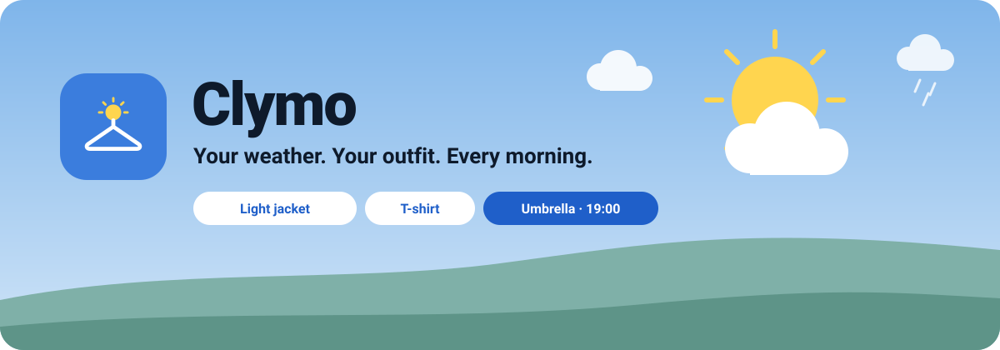
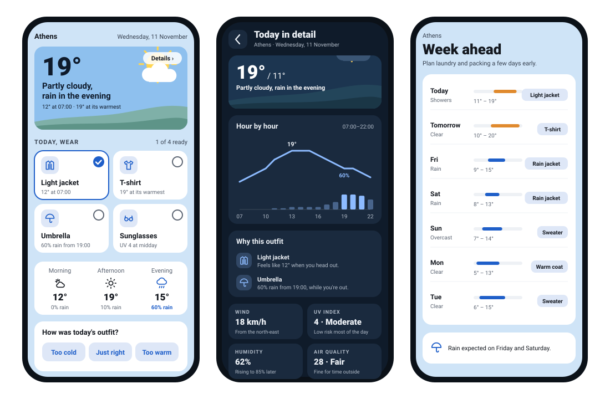
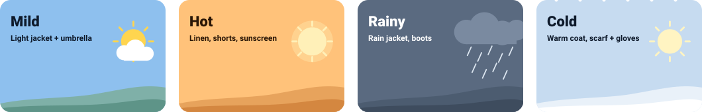

  

  
  
  
  

**DressCast** turns the weather forecast into a simple answer to the question you actually ask every morning: *what should I wear?*

At the time you choose, it sends a notification like **"Light jacket + umbrella today"**. Open the app to see the outfit, tick items off as you get dressed, and find out exactly why each one was picked. No account, no ads, no tracking.

  

## Features

**Every morning**
- A notification at the time you pick, with the outfit and the day's weather
- An optional 21:00 preview of tomorrow's outfit
- A warning about an hour before rain starts, while you're out

**In the app**
- Animated weather picture with the temperature and a one-line summary
- Outfit cards you can tick off, plus morning, afternoon and evening at a glance
- Tap the picture for **Today in detail**: an hour-by-hour chart, why each item was chosen, wind, UV, humidity, sunrise and sunset, rain and air quality, and a comparison with yesterday
- **Week ahead** with what to wear each day
- Light and dark mode, English and Greek, °C and °F

**Advice that fits you**
- Tell it whether you usually feel colder or warmer than other people
- Answer "too cold / just right / too warm" and it adjusts over time
- Set the hours you're usually outside, so evening rain only counts if you're still out
- Turn off accessories you can't or don't want to wear (like sunglasses or an umbrella), and it suggests an alternative

**Built to be dependable**
- Works offline with the last forecast
- Checks that your phone's battery saver won't block the reminder, with a one-tap fix
- Updates itself: when a new version is published, tap **Update** in the app

## Four weather moods

The colours and the picture follow the day's weather.

  

## Widgets

One **DressCast** widget that changes layout as you resize it, from a single tile up to a big panel, plus a **Checklist** widget (ticks sync with the app) and a **Next days** widget.

  

To add one, long-press your home screen, choose **Widgets** and find **DressCast**.

## Install

1. On your phone, open the **[latest release](https://github.com/Vyto-Line/DressCast/releases/latest)** and tap **DressCast.apk**.
2. Allow your browser to install apps if Android asks.
3. Open DressCast, pick your location, reminder time and how you feel the cold, and you're done.

After that, updates arrive inside the app. The first time, Android asks you to allow DressCast to install updates.

**If your morning reminder doesn't arrive:** open **Settings → Reminders on time** in the app and follow the suggestion there. Xiaomi, Samsung and Huawei phones are the most likely to stop background apps.

## How the advice works

DressCast looks at the **feels-like** temperature during the hours you're outside, not just the daily high. It shifts that by your own comfort setting and what it has learned from your feedback, picks the clothing for that range, and then adds what the day needs: an umbrella when rain is likely while you're out, sunglasses or sunscreen for strong UV, a windproof layer on windy days, boots for snow.

## Privacy

- No account, no ads, no analytics.
- Your location is only used to get the forecast, at city level (coarse location), and only if you choose "Use my location".
- Weather comes from [Open-Meteo](https://open-meteo.com), and updates are checked against this GitHub page. Nothing else leaves your phone.

## Build it yourself

Every push to `main` is built by GitHub Actions (see `.github/workflows/build.yml`). Commits whose message contains `[release]` also publish a new release, which the app picks up as an update.

To build locally, open the project in Android Studio. First download the two fonts into `app/src/main/res/font/` as `inter.ttf` and `space_grotesk.ttf`; the workflow file shows where they come from.

## Credits

- Weather and air quality data: [Open-Meteo](https://open-meteo.com) (CC BY 4.0)
- Fonts: [Inter](https://rsms.me/inter/) and [Space Grotesk](https://floriankarsten.github.io/space-grotesk/), SIL Open Font License
- Built with Kotlin and Jetpack Compose

## License

[MIT](LICENSE)
